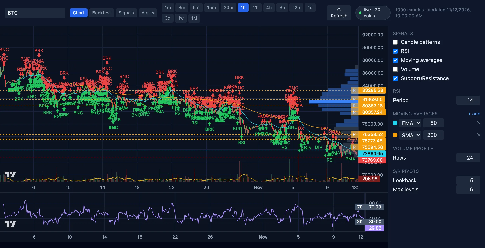
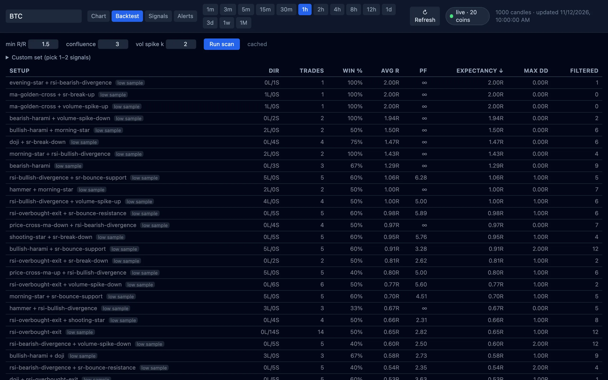
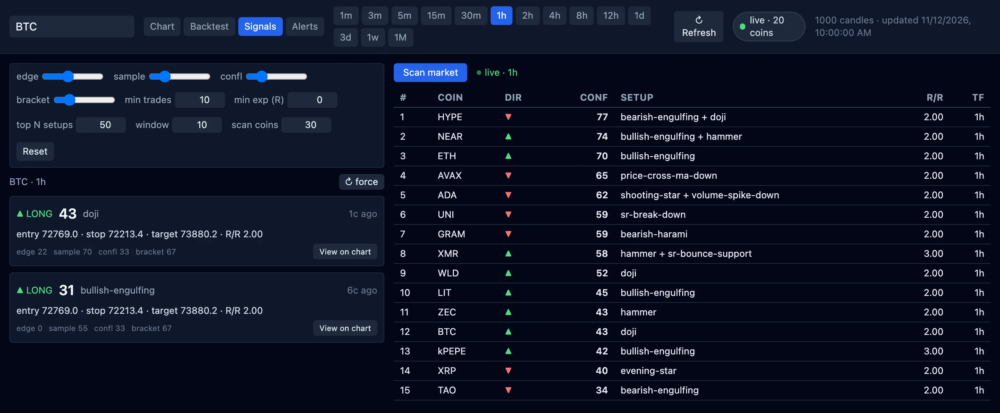
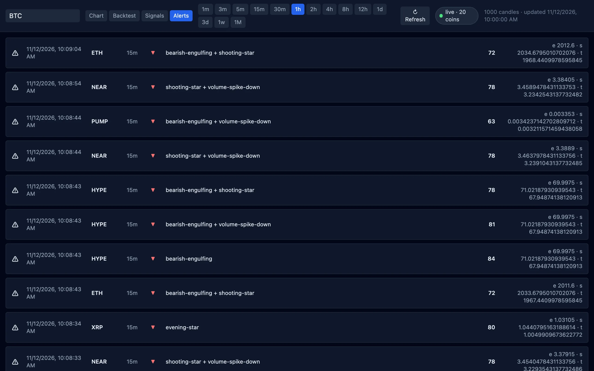
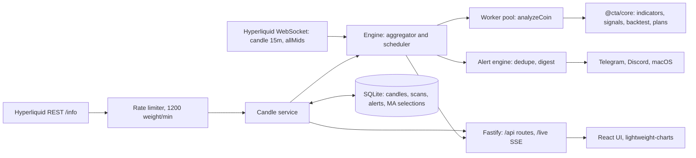

# crypto-token-analysis

A local tool that charts Hyperliquid perpetual futures, backtests candle and indicator signals on them, and sends an alert when a backtested setup fires on live data.

**Status: work in progress.** Phases 1 to 4B work today: charting, pattern backtests, confidence-scored trade plans, a 24/7 alert engine and a live dashboard. Phase 5, trade execution, is listed in the Phase 4A spec as deferred work, and no code for it exists.



## What it is

I wanted to know which chart signals paid off on each Hyperliquid pair before trusting them, and I wanted to stop watching charts to find out when one fired. This repo does both on one machine.

It pulls candles from Hyperliquid's public API, computes indicators and support and resistance levels, and detects 25 signal kinds in five families: candle patterns, RSI, moving averages, volume and support/resistance. A backtester runs every signal and every same-direction pair of signals over the history and ranks them by expectancy in R. The setups that clear a gate become trade plans with an entry, stop, target, risk/reward and a confidence score from 0 to 100.

A 24/7 engine inside the server keeps that running on live data. It subscribes to Hyperliquid's WebSocket, re-scans a coin when one of its candles closes, and pushes alerts to Telegram, Discord or macOS notifications.

It reads public market data only. There is no wallet, account, order or position code anywhere in the repo. It is an analysis tool and not financial advice.

## What works today

- Chart any Hyperliquid perp on all 14 intervals with RSI, SMA, EMA, volume, a volume profile and volume-weighted pivot levels. Evidence: the screenshot above, `packages/core/test/`.
- See all 25 signal kinds as markers on the chart, toggled by family. Evidence: `packages/core/test/detectors.test.ts`, `e2e/phase2.mjs`.
- Backtest every single signal and every same-direction pair for a coin and interval, ranked by expectancy and cached in SQLite. Evidence: `POST /api/backtest`, `packages/core/test/scan.test.ts`.
- Get trade plans with a four-part confidence score, and sweep the top coins by 24h volume for the best active plan. Evidence: `POST /api/signals`, `packages/core/test/plans.test.ts`, `e2e/phase3.mjs`.
- Run the engine around the clock. It builds 1h, 4h and 1d candles from the 15m stream, scans on every close, checks forming candles on price ticks, and alerts with dedupe and a burst digest. Evidence: `e2e/phase4a.mjs`, `apps/server/test/`.
- Let a nightly optimizer pick a moving-average pair per coin and timeframe from 76 combinations, kept only when it beats the default out of sample. Evidence: `packages/core/test/maGrid.test.ts`, `e2e/phase4b.mjs`.
- Watch the scanner, alert feed and engine health update live over server-sent events. Evidence: `GET /live`, `e2e/phase4b.mjs`.
- Run 371 tests in 81 files with `pnpm -r test`.

### Next

- Phase 5, trade execution: wallet signing, order lifecycle, risk limits, kill switch and paper mode. The engine's plan output is its input contract.
- Alerts for a plan's lifecycle: entry filled, stop hit, target hit.
- UI controls for per-coin moving-average overrides.
- A Rust port of the analysis kernel, only if the latency budget below is breached.
- Spot markets and synthetic cross pairs such as BTC/ETH.

## Look



The backtest tab. Every single signal and same-direction pair, ranked by expectancy. A setup with fewer than 20 trades gets a low-sample badge.



The signals tab. Plans for the selected coin on the left, each with its confidence broken into edge, sample, confluence and bracket. The scanner on the right updates live from the engine.



The alert feed. I captured it with the alert bars lowered to 40 and 60 so it filled within minutes; the defaults are 65 and 75. Clicking a row opens that chart with the plan's lines.

The screenshots come from `node docs/readme/capture.mjs`, which records its own setup in its header.

## Run it

| Fact | Value |
| --- | --- |
| Runtime | Node.js 22, tested on 22.18.0 |
| Package manager | pnpm 9.1.0, pinned in `package.json` |
| Operating system | Tested on macOS. The engine has no macOS-only code; only the notification sink needs macOS |
| External services | Hyperliquid public REST and WebSocket API, no account. Telegram and Discord only for alerts |
| Paid keys needed | No |
| Ports | 3001 for the API and engine, 5173 for the web dev server |
| Time to first run | 14 s to install here, and the API answered within 30 s. The engine then backfills coins in 24h-volume order; the Phase 4A spec puts the full universe at about 75 min |

1. Clone the repo.

```bash
git clone https://github.com/kevinshibuya/crypto-token-analysis.git && cd crypto-token-analysis
```

Expect: a `crypto-token-analysis` directory with `apps/`, `packages/` and `pnpm-lock.yaml`.

2. Install dependencies.

```bash
pnpm install
```

Expect: the last line reads `Done in` followed by a time.

3. Start the API and the engine. The `start` script sets `ENGINE_ENABLED=1` by default.

```bash
pnpm --filter @cta/server start
```

Expect: `server listening on http://0.0.0.0:3001`, after a warning that `apps/web/dist` is missing and the server serves the API only.

4. In a second terminal, check the engine.

```bash
curl -s localhost:3001/api/health
```

Expect: JSON with `"status":"ok"` and an `engine` block whose `coinsLive` count grows on each call.

5. In a third terminal, start the web UI.

```bash
pnpm --filter @cta/web dev
```

Expect: `Local:   http://localhost:5173/`.

6. Check that the UI's proxy reaches the API.

```bash
curl -s localhost:5173/api/markets | head -c 120
```

Expect: JSON that starts with `{"markets":[` followed by the first market, `BTC`.

Then open http://localhost:5173 in a browser. It shows the BTC 1h chart.

### Check it works

```bash
pnpm -r test
```

Expect one summary per package, in this order: `Test Files  28 passed (28)` for core, `Test Files  35 passed (35)` for the server and `Test Files  18 passed (18)` for the web app.

### Environment variables

Nothing loads a `.env` file. Export these or prefix the start command with them. `engine.json` in the repo root is optional; copy `engine.json.example` to tune thresholds, timeframes and the optimizer.

| Name | Required | What it does | How to get a value |
| --- | --- | --- | --- |
| `TELEGRAM_BOT_TOKEN` | Optional | With `TELEGRAM_CHAT_ID`, turns on the Telegram sink | Create a bot with Telegram's BotFather |
| `TELEGRAM_CHAT_ID` | Optional | The chat that receives alerts | The id of the chat or channel the bot posts to |
| `DISCORD_WEBHOOK_URL` | Optional | Turns on the Discord sink | Channel settings, Integrations, Webhooks in Discord |
| `ENGINE_MACOS_NOTIFY` | Optional | `1` turns on macOS notifications | Set it to `1` |
| `ENGINE_ENABLED` | Optional | `1` runs the engine. `start` defaults it to `1`; `dev` leaves it off | `1` or `0` |
| `ENGINE_UNIVERSE_CAP` | Optional | Tracks only the top N coins by 24h volume; `0` tracks all | A number, for example `20` |
| `ENGINE_TIMEFRAMES` | Optional | Timeframes the engine scans, default `15m,1h,4h,1d`; must include `15m` | A comma-separated list |
| `ENGINE_WORKERS` | Optional | Analysis worker threads, default CPU count minus 2 | A number |
| `ENGINE_CONFIG` | Optional | Path to the engine config, default `engine.json` | A file path |
| `ENGINE_WEB_ORIGIN` | Optional | Base URL for alert deep links | `http://localhost:3001` when the server serves the built UI |
| `ENGINE_LOG_DIR` | Optional | Engine log directory, default `data/logs` | A directory path |
| `HL_BASE_URL` | Optional | Hyperliquid API base | `https://api.hyperliquid-testnet.xyz` for testnet |
| `PORT` | Optional | API port, default `3001` | A free port |
| `CACHE_DB_PATH` | Optional | SQLite cache path, relative to `apps/server`, default `data/cache.sqlite` | A file path |

### If it fails

- `curl localhost:3001/health` returns 404. The route is `/api/health`.
- `localhost:3001/` serves no UI and the log says `web dist not found`. Run `pnpm --filter @cta/web build` once; the server then serves the dashboard at its own origin.
- Under launchd the job fails with `Operation not permitted`. The repo sits under `~/Desktop`, `~/Documents` or `~/Downloads`, which macOS blocks for background jobs. Move it. `docs/ops-mac.md` covers the full launchd setup.

For agents: this repo has no `CLAUDE.md` or `AGENTS.md`. The design rules live in [`docs/superpowers/specs/`](docs/superpowers/specs/), and each plan in [`docs/superpowers/plans/`](docs/superpowers/plans/) records its deviations inline.

## How it's built



| Path | What lives there |
| --- | --- |
| `packages/core/src` | Pure TypeScript math with no I/O: indicators, pivots, volume profile, `analyzeCoin` |
| `packages/core/src/patterns`, `signals` | The 25 signal detectors |
| `packages/core/src/backtest`, `decide`, `optimize` | Simulation and scan, trade plans and confidence, the MA grid |
| `apps/server/src/hyperliquid` | REST client, pagination past the 5000-candle cap, rate limiter |
| `apps/server/src/engine` | WebSocket feed, candle aggregation, scheduler, worker pool, alert engine, sinks, watchdog |
| `apps/server/src/routes`, `cache` | HTTP and SSE routes, SQLite stores |
| `apps/web/src` | React UI: chart, backtest, signals and alerts tabs |
| `e2e/` | Puppeteer scripts that drive each phase against live Hyperliquid |
| `docs/superpowers/` | One design spec and one implementation plan per phase |
| `docs/ops-mac.md`, `ops/` | Runbook and launchd plist for running the engine 24/7 on a Mac |

## Why it's built this way

**Backtests use only pivots that existed at each bar.** Pivot levels were first computed once over the whole history, so early backtested trades got stops, targets and support/resistance signals from structure that had not formed yet. At the Phase 2 checkpoint I chose to fix it rather than document it, in all three places: signal detection, entry brackets and the in-trade stop moves. The cost was quadratic work per scan, which the later performance spec cut by building the walk-forward levels from one pass over the history. [Phase 2 spec](docs/superpowers/specs/2026-06-10-phase2-analysis-design.md), [performance spec](docs/superpowers/specs/2026-06-13-core-calc-signal-perf-correctness-design.md).

**An alert inside a candle is provisional, and the close confirms or withdraws it.** Waiting for the close is slow on a 4h or 1d candle, and alerting on a forming candle alone would repaint without saying so. A provisional alert needs confidence 75; at the close exactly one follow-up fires, confirmed or withdrawn. A setup on a closed candle needs confidence 65. One alert identity fires once while its plan is alive and not again for 6 hours after it expires. [Phase 4A spec](docs/superpowers/specs/2026-06-11-phase4a-continuous-engine-design.md).

**The backend computes and the frontend only renders.** One server owns the 1200-weight-per-minute Hyperliquid budget and the candle cache, so the browser never calls Hyperliquid. The same `@cta/core` functions serve the chart, the backtester and the engine. The cost is a round trip for every indicator change, which the UI debounces by 300 ms. [Phase 1 spec](docs/superpowers/specs/2026-06-09-phase1-foundation-design.md).

**The engine stays in TypeScript until a written latency budget breaks.** All analysis goes through one pure function, `analyzeCoin`, so a Rust port would replace one function behind the same signature. The budget is a single scan under 250 ms at p95 and the full universe under 30 s after a close, and 24 hours of sustained breach is the trigger. When `analyzeCoin` measured about 255 to 280 ms at p95 on an 8 GB M1, the performance spec answered with complexity fixes, starting with the pivot code, and the port stayed shelved. [Phase 4A spec](docs/superpowers/specs/2026-06-11-phase4a-continuous-engine-design.md), [performance spec](docs/superpowers/specs/2026-06-13-core-calc-signal-perf-correctness-design.md).

**Alert channels are pluggable sinks that fail alone.** Telegram, Discord and macOS each get 3 attempts with backoff, then the alert is logged and dropped for that sink; a failing sink never blocks the engine or the others. A sink with no config is off, and every alert persists in SQLite either way. This kept the engine free of macOS-only code paths for a later move to a Linux server. [Phase 4A spec](docs/superpowers/specs/2026-06-11-phase4a-continuous-engine-design.md).

**A tuned moving-average pair has to beat the default on data it never saw.** The nightly optimizer trains on the oldest 70% of candles and validates on the newest 30%. The winner replaces EMA 50 / SMA 200 only with at least 20 training trades, at least 8 validation trades and better validation expectancy. Whether a challenger wins depends on the market, so the e2e test checks that no decision fails and that each winner has exactly one stored row, not that one wins. [Phase 4B spec](docs/superpowers/specs/2026-06-11-phase4b-live-dashboard-ma-design.md).

**Two support/resistance methods run side by side.** The volume profile marks where volume traded, and volume-weighted swing pivots mark turning points; I wanted to compare them on the same chart before trusting either. Both stay on. The profile is display only, drawn at the chart's right edge, and the pivots feed the signals and the stop and target brackets. [Phase 1 spec](docs/superpowers/specs/2026-06-09-phase1-foundation-design.md).

## How it was made

Each phase started as a design spec with a checklist and became a task-by-task plan in `docs/superpowers/`. Agents in Claude Code built the tasks one at a time, a reviewer checked each one, and each plan records where reality forced a deviation. A live puppeteer run in `e2e/` gated every phase before merge, and I made the calls at the checkpoints, such as fixing the pivot lookahead.

## Credits and licence

| Component | Licence |
| --- | --- |
| [TradingView Lightweight Charts](https://www.tradingview.com/lightweight-charts/) | Apache-2.0. The chart shows TradingView's attribution logo, linking to tradingview.com, as its licence asks |
| React, Vite, Tailwind CSS, Fastify, better-sqlite3, pino, ws, tsx | MIT |
| puppeteer-core, used by the e2e and capture scripts | Apache-2.0 |

Market data comes from Hyperliquid's public API. This is an analysis tool and not financial advice.

MIT, Copyright (c) 2026 Kevin Shibuya. See [LICENSE](LICENSE).
